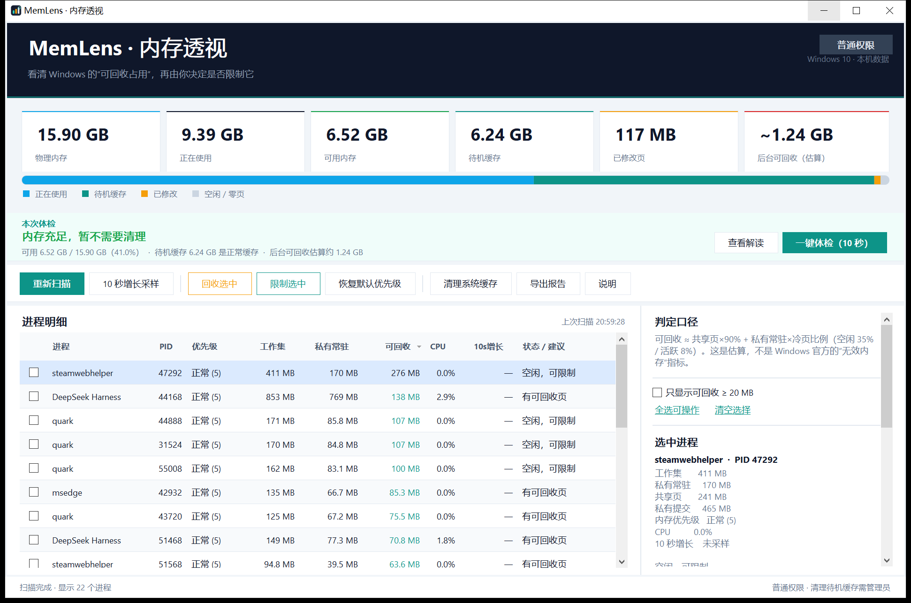

# MemLens 内存透视

> 看清 Windows 的“可回收占用”，再由你决定是否限制它。

> **本内容由 deepseek 完成，请用户自行检查合理性。**

一个面向 Windows 10/11 的本地小工具：打开后先给出一句“小白结论”，再逐进程展示工作集、私有常驻、共享页、私有提交、内存优先级和 10 秒增长；让你自己勾选，再选择“温和限制（内存优先级 1 级）”或“立即回收一次”。附带一个只读 PowerShell 诊断脚本。



## 先给结论

1. **Windows 没有“无效内存”这个官方指标。** 本工具统计的是“可回收/可裁剪”的近似值。
2. **待机缓存不是故障。** 内存越大，Windows 越会把空闲内存用于文件缓存；它在内存紧张时会自动回收。为了数字好看而频繁清缓存，通常只会让程序重新读盘。
3. **工作集大不等于泄漏。** 浏览器、Electron、.NET/Java 运行时会根据可用内存扩大堆和缓存；系统不紧张时也不会急着修剪工作集。
4. **更值得怀疑的是私有提交持续增长。** 用“10 秒增长采样”连续观察，比看单次工作集更有意义。
5. **不建议硬上限。** 强制工作集上限会造成频繁换页、卡顿，而且不能修复泄漏。本工具用 Windows 原生内存优先级做软限制。

## 文件

| 文件 | 说明 |
| --- | --- |
| `dist/MemLens.exe` | 主程序，无需安装；依赖 Windows 10/11 自带的 .NET Framework 4.x |
| `dist/MemLens.exe.config` | 声明 .NET 4.x 兼容性；与 EXE 放在同一目录 |
| `dist/Get-MemoryDiagnosis.ps1` | 只读诊断脚本，不修改系统，可导出 CSV |
| `dist/README.md` | 本说明 |
| `dist/USAGE.txt` | 给最终用户的简短使用说明 |
| `src/` | C# 源码（WinForms + P/Invoke） |
| `build.ps1` | 一键重新编译 |
| `tests/` | 自检、回收测试、界面截图 |

## 快速开始

### 图形界面

1. 双击 `MemLens.exe`。
2. 等 1～2 秒扫描完成，先看顶部的“本次体检”横幅：一句话告诉你内存够不够、要不要清理。
3. 点“查看解读”看小白版报告；点“一键体检（10 秒）”会自动扫描并做一次增长采样，再给出完整结论。
4. 需要处理具体程序时：按“可回收”列排序，勾选高占用、低 CPU 的后台程序。
5. 点“限制选中”：
   - **温和限制（推荐）**：内存优先级设为 1 级，并可勾选“同时立即回收一次”。
   - **只回收一次**：不改变优先级。
   - **恢复默认**：优先级改回 5 级。
6. 需要立刻腾出物理内存时，再点“回收选中”。程序下次访问会重新读盘，可能短暂卡顿。
7. “清理系统缓存”需要管理员权限；只建议偶尔使用，优先选“仅低优先级待机页”。

> 这是未签名的小工具。首次运行若被 SmartScreen 拦截，点“更多信息 → 仍要运行”；也可以右键文件 → 属性 → 解除锁定。源码在 `src/`，可自行审查或重编译。

### 只读脚本

```powershell
powershell -ExecutionPolicy Bypass -File .\Get-MemoryDiagnosis.ps1 -Top 30
powershell -ExecutionPolicy Bypass -File .\Get-MemoryDiagnosis.ps1 -Top 30 -ExportCsv
```

脚本不需要管理员，不回收任何内存，只输出系统概况、可回收估算和 Top 进程；`-ExportCsv` 会生成 UTF-8 BOM 的 CSV，Excel 可直接打开。

## 界面怎么读

| 数字/列 | 含义 | 是否精确 |
| --- | --- | --- |
| 物理内存 | 总物理内存 | 精确 |
| 正在使用 | 总内存 − 可用内存；不含待机缓存 | 精确 |
| 可用内存 | Windows 认为可立即使用的内存，包含空闲页和待机缓存 | 精确 |
| 待机缓存 | 待机列表中的文件缓存页 | 精确（`NtQuerySystemInformation`） |
| 已修改页 | 已修改、尚未写回磁盘的页 | 精确 |
| 工作集 | 进程当前驻留在物理内存中的页 | 精确 |
| 私有常驻 | 只属于该进程的常驻页 | 精确 |
| 共享页 | 工作集 − 私有常驻（DLL/文件映射等） | 精确 |
| 私有提交 | 进程已提交的私有虚拟内存；泄漏观察重点 | 精确 |
| 可回收 | 共享页 × 90% + 私有常驻 × 冷页比例 | **启发式估算** |
| CPU | 扫描前 0.65 秒的 CPU 占用（全机归一化） | 采样值 |
| 10s 增长 | 最近一次 10 秒采样的私有提交变化 | 采样值 |

估算公式：

```text
可回收 ≈ 共享页 × 0.90 + 私有常驻 × 冷页比例
冷页比例 = 空闲（CPU < 1%）时 0.35；活跃时 0.08；CPU 未知时 0.18
结果上限 = 工作集 − 4 MB
```

为什么是估算：Windows 没有公开“这个进程的哪一页是冷页”的稳定接口。工具用 CPU 活跃度和共享页比例做保守估计；真正回收时的实测减少量会在操作后显示。

## “无效占用”到底是什么

可以把内存分成四层看：

1. **空闲页 / 零页**：完全空闲，随时可用。
2. **待机缓存**：Windows 缓存的文件页，内存紧张时自动回收；不是故障。
3. **进程工作集**：进程当前常驻物理内存的页，包含共享页和私有页；系统不紧张时不会急着修剪。
4. **私有提交**：进程已提交的私有虚拟内存。它持续上涨，才更接近“泄漏”。

所以：

- 任务管理器“使用中”高，不一定是坏事；看可用内存和提交内存。
- 待机缓存高，不是“无效占用”；它只是缓存。
- 进程工作集高，也不一定是泄漏；可能是缓存/堆。
- 私有提交持续上涨，才值得进一步查这个进程。

本工具把“可回收”拆成两部分展示：

- **系统待机 + 已修改**：来自内存列表，统计精确，但清理它们是“扔掉缓存”，不是修复故障。
- **后台进程逐项合计**：启发式估算，含共享页，多个进程之间可能重复计算；只用于排序和筛选，不是精确总量。

## 为什么内存越大，同样的后台占用越多

这是正常现象，主要有三个原因：

1. **Windows 会拿空闲内存做缓存。** 物理内存越大，待机缓存越多；系统在需要时自动回收。
2. **应用会按可用内存扩张。** 浏览器、Electron、.NET/Java 运行时会扩大堆、缓存或页面池；内存越充足，越不急着释放。
3. **系统不紧张时不会修剪工作集。** 页留在物理内存里，下一次访问更快；只有内存压力上来才回收。

因此，“占用数字变大”本身不是问题。真正值得关注的是：

- 可用内存长期很低（例如长期低于 10%～15%）；
- 提交内存接近上限；
- 某个进程的私有提交在多次采样中持续增长；
- 系统出现明显卡顿、换页或程序崩溃。

## 建议工作流

1. **先扫描，不操作。** 看“可用内存”“提交内存”和 Top 进程。
2. **做一次 10 秒增长采样。** 按“10s 增长”排序；正数不一定是泄漏，连续两次都明显增长才可疑。
3. **对高占用、低 CPU 的后台程序做温和限制。** 内存优先级 1 级；需要立即生效时勾选“同时回收一次”。
4. **确实需要物理内存时，再回收选中进程。** 回收是“把页移出工作集”，不是降低提交内存，也不是修复泄漏。
5. **待机缓存只在有明确需求时清理。** 优先“仅低优先级”；不要定时/频繁清理。

## 限制模式与安全边界

### 温和限制（内存优先级）

`SetProcessInformation(ProcessMemoryPriority)` 把进程默认页优先级设为 1 级（最低）。系统修剪工作集时优先回收它；内存充足时它仍可正常使用。**这是软限制，不是硬上限。**

- 只影响回收顺序，不阻止进程申请内存。
- 进程退出/重启后失效。
- 对管理员权限运行的进程，普通权限的 MemLens 可能无法设置。

### 为什么没有硬上限

`SetProcessWorkingSetSizeEx(..., QUOTA_LIMITS_HARDWS_MAX_ENABLE)` 可以设置硬上限，但会让进程频繁换页，严重时卡顿甚至影响稳定性；它也不能修复泄漏。因此没有把它做成默认功能。

### 安全边界

- 不自动清理；所有写操作都要先勾选、再确认。
- 不安装驱动、不注册服务、不修改注册表。
- 不碰系统关键进程、其他会话进程和工具自身。
- 只操作当前会话、当前用户有权限打开的进程。
- 无网络请求、无遥测。

## 兼容性：换一台机器能直接开吗

可以，前提是 **Windows 10 / 11**：

- 同一个 `MemLens.exe` 可以直接复制到其他 Windows 10/11 机器，不需要 Python、Node、数据库或安装包。
- 程序只引用 .NET Framework 4.0 的程序集；Windows 10/11 自带 .NET Framework 4.x，所以通常双击即可。
- 已适配 Windows 系统缩放（100%～200%）；在 150% 缩放下按物理像素渲染，不再由系统位图拉伸，所以文字和表格是清晰的。
- 请把 `MemLens.exe` 和 `MemLens.exe.config` 放在同一目录；配置文件只是声明兼容性，误删通常也能启动。
- 极少数被精简过、移除了 .NET Framework 的系统需要先启用/安装 .NET Framework 4.8。
- 不支持 Windows 7/8：本工具使用了 Windows 10 的内存优先级与进程内存 API。
- 未签名，可能触发 SmartScreen；这是分发方式问题，不是缺少运行库。

## 构建

环境：Windows 10/11，.NET Framework 4.8（系统自带），PowerShell 5.1。无需 NuGet、无需联网。

```powershell
powershell -ExecutionPolicy Bypass -File .\build.ps1
```

脚本会调用 `C:\Windows\Microsoft.NET\Framework64\v4.0.30319\csc.exe`，编译 `src/*.cs`，嵌入 `app.manifest` 和 `MemLens.ico`，输出到 `dist/`，并打印 SHA256。

自检：

```powershell
Start-Process -FilePath .\dist\MemLens.exe -ArgumentList "--selftest",".\dist\selftest.txt" -Wait
Get-Content .\dist\selftest.txt
```

命令行选项：

```text
MemLens.exe                        启动图形界面
MemLens.exe --scan [报告.txt]      只扫描并输出文本报告
MemLens.exe --export [报告.csv]    扫描并输出 CSV
MemLens.exe --selftest [报告.txt]  内置自检
MemLens.exe --trim-test [报告.txt] 启动记事本并实测一次工作集回收
MemLens.exe --purge-low [报告.txt] 清理低优先级待机缓存（需管理员）
MemLens.exe --purge-all [报告.txt] 清理全部待机缓存（需管理员）
```

## 测试记录

测试机：Windows 10 22H2 build 19045，x64，15.9 GB 物理内存，12 个逻辑处理器，150% 系统 DPI。

- `--selftest`：PASS。物理内存、可用内存、待机列表、提交上限、进程枚举、CPU 采样、估算边界、内存优先级读/写/恢复均通过。
- `--trim-test`：PASS。新建 `notepad.exe`，工作集 14.7 MB → 0 MB，实测减少 14.7 MB。
- PowerShell 脚本：正常输出系统概况、Top 进程和 CSV（UTF-8 BOM）。
- 界面：主窗口、体检横幅、小白解读、限制对话框、清理对话框、帮助页均在 150% DPI 下截图检查；按物理像素渲染，文字清晰，布局与滚动正常。
- 一键体检：扫描 → 10 秒增长采样 → 自动弹出小白报告，实测通过。
- 权限失败路径：非管理员调用 `--purge-low` 返回 `0xC0000061`（权限不足），程序给出可读提示，不崩溃。
- **未覆盖**：管理员清理待机缓存的成功路径（测试环境无法走 UAC）；跨进程设置内存优先级（测试会话是低完整性，系统拒绝写入）；建议在正常桌面会话中实际验证这两项。

当前测试环境是受限会话，只能枚举到约 13 个可见进程；正常用户令牌下会枚举当前会话所有可访问进程。界面中的“显示 13 个进程”是测试环境现象，不是程序上限。

## 已知限制

- “可回收”是估算，不是精确的“无效内存”；共享页在多个进程间可能重复计算。
- 内存压缩、驱动锁定页等没有单独拆分展示。
- 受保护进程、其他用户/会话进程、管理员权限进程可能无法读取或操作；这是 Windows 权限模型，不是程序故意隐藏。
- 未签名，可能触发 SmartScreen 或杀毒软件启发式误报。
- 主要按 x64 Windows 10 测试；AnyCPU 理论支持 32 位，但未在 32 位系统实测。
- 不提供定时自动清理，避免把“清理”变成新的后台负担。

## 同类软件与设计取舍

同类工具通常做三件事：

- **清空待机列表**：RAMMap 的 Empty Standby List、EmptyStandbyList 等。
- **修剪进程工作集**：Mem Reduct 的一键清理、CleanMem 的定时修剪等。
- **按规则限制/修剪**：Process Lasso 的 SmartTrim、内存优先级列等。

本工具的区别：

- 不自动清理，先给证据（工作集、私有常驻、共享页、私有提交、10 秒增长）。
- 把“系统缓存”和“进程可回收”分开，避免把待机缓存说成“无效内存”。
- 用内存优先级做可逆软限制，而不是硬上限。
- 附带只读脚本，方便先诊断再决定。

## 参考

- Microsoft：`SetProcessInformation`（内存优先级）  
  https://learn.microsoft.com/en-us/windows/win32/api/processthreadsapi/nf-processthreadsapi-setprocessinformation
- Microsoft：`EmptyWorkingSet`（工作集回收）  
  https://learn.microsoft.com/en-us/windows/win32/api/psapi/nf-psapi-emptyworkingset
- Microsoft：`SetProcessWorkingSetSizeEx`（硬上限的风险）  
  https://learn.microsoft.com/en-us/windows/win32/api/memoryapi/nf-memoryapi-setprocessworkingsetsizeex
- Sysinternals RAMMap（待机列表可视化）  
  https://learn.microsoft.com/en-us/sysinternals/downloads/rammap
- Mem Reduct 功能（实时 RAM、清理规则、便携模式）  
  https://memreduct.dev/cn/features.html
- Process Lasso 列说明（含内存优先级/SmartTrim 相关功能）  
  https://bitsum.com/apps/process-lasso/docs/interface/columns/#columns_selection
- Microsoft Q&A：Windows 待机内存为什么很大  
  https://learn.microsoft.com/en-us/answers/questions/3150421/windows-takes-26-5-gb-ram-in-standby
